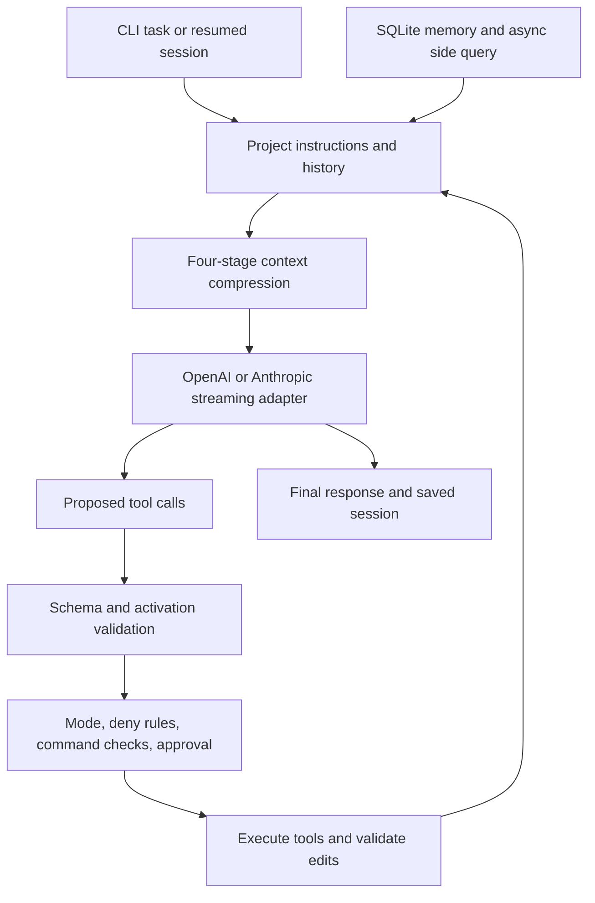

# Runtime design

The model decides what to do next. Python validates the proposed tool call, checks policy, executes supported operations, and returns structured results. The evaluator independently determines whether a benchmark task succeeded.

## Tool scheduling

Only five tool schemas are initially visible. `discover_tools` activates schemas by matching names and descriptions. This avoids sending the whole registry in every initial request. `--eager-tools` provides an explicit comparison baseline.

Read-only tools can execute concurrently. On the Anthropic path, a completed tool block can trigger an enabled read while other response blocks are still streaming. Mutating tools wait until the full response is available. Concurrency fallback retries read operations serially and does not replay writes.

Provider retries use bounded exponential backoff and jitter for network errors, HTTP 429, and server failures. Once text has been emitted or a tool has been dispatched, a partially completed response is not replayed.

## Context and memory

Compression progresses from output head/tail truncation to removing superseded reads, trimming old tool detail, and summarizing older execution history. Complete tool-call/result rounds stay paired. The budget is a trigger measured in serialized characters, so retained instructions and recent rounds can exceed it.

Persistent notes are stored in SQLite. Retrieval expands a task into related search terms, ranks lexical and recent candidates with the model, and attaches age and freshness information. Prefetch overlaps retrieval with main-loop work. Failures fall back to lexical matching and are labeled accordingly.

## Editing and permissions

File tools resolve paths inside the workspace and protect configuration, Git metadata, and agent state. Existing files require a prior read; their digest must still match when written. Exact replacement must match once, and Python syntax is checked before the original file is modified.

Mode checks and declarative rules govern writes and execution. Dangerous-command patterns and denials run before user approval. Supported process calls use argument arrays with `shell=False` and a small command allowlist. These checks reduce accidental misuse; running Python tests still executes arbitrary project code and requires a separate isolation boundary for untrusted inputs.

## Evaluation boundary

Audit copies each fixture, stores verifier assertions outside the editable workspace, and restricts agent file tools to contract-approved paths. A separate subprocess loads the final implementation and checks the stored assertions. Reports retain tool traces and classify failures before aggregating pass rate, tool count, safety blocks, character compression, timing, and provider-reported usage.

The bundled 26 tasks are small reconstructed Python function repairs. Passing them does not establish general repository-scale coding ability, and offline reference validation does not measure model performance. Process separation is useful for ordinary regression evaluation; it is not a sandbox against malicious submitted code.
